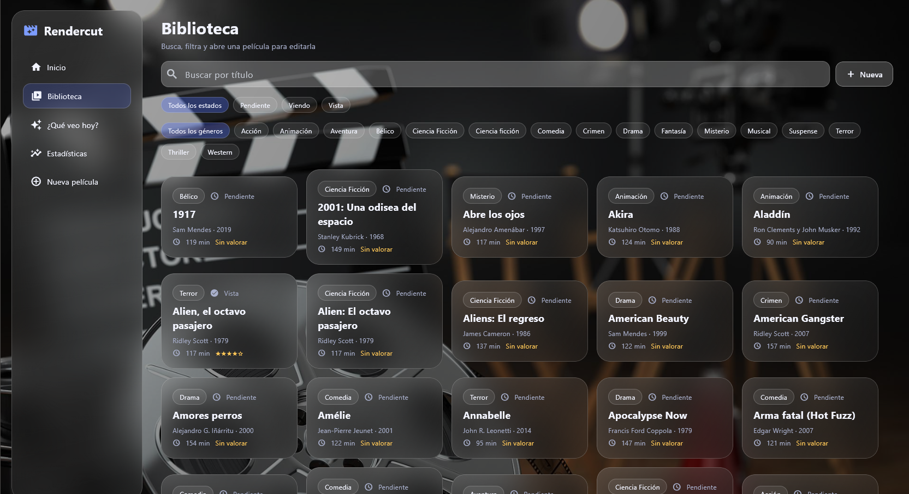
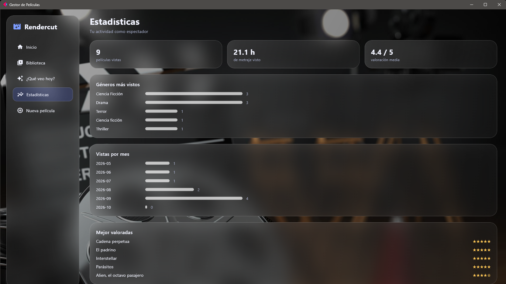

# Rendercut 🎬

**Tu próxima película, según tus gustos y el tiempo que tienes.**

Aplicación de escritorio para cinéfilos que permite organizar películas,
registrar valoraciones y obtener recomendaciones personalizadas entre
los títulos pendientes.

Desarrollada con **Python, Flet y SQLite**, con una interfaz oscura
de estilo glassmorphism.



## Funcionalidades

- **Biblioteca:** añadir, editar y eliminar películas, buscar por título
  y filtrar por género y estado.
- **Diario de cine:** registrar películas pendientes, viendo o vistas,
  con valoración de 1 a 5, fecha de visionado y notas.
- **¿Qué veo hoy?:** recibir hasta tres recomendaciones ajustadas
  al tiempo disponible, con una explicación de cada sugerencia.
- **Estadísticas:** películas vistas, horas de metraje, valoración media,
  géneros favoritos y actividad mensual.
- **Datos limpios:** los géneros se normalizan al guardar y la app avisa
  si intentas añadir una película que ya tienes.
- **Carátulas y sinopsis:** se pueden traer desde TMDB, de forma opcional,
  para una película o para toda la biblioteca.
- **Almacenamiento local:** colección guardada en SQLite, sin necesidad
  de una cuenta.

## Recomendaciones explicables

El motor utiliza reglas, no inteligencia artificial: selecciona películas
pendientes que caben en el tiempo disponible y las ordena combinando
afinidad por género, afinidad por director y ajuste de duración.

Las afinidades se calculan a partir de tus valoraciones anteriores.
Si aún no has valorado películas, las sugerencias se basan en la duración
y los filtros seleccionados.

> «Dura 110 minutos y tienes 120; sueles puntuar bien la ciencia ficción
> (media 4,5/5)».

## Estadísticas



## Desarrollo

- **Python:** modelo, validación y lógica de negocio.
- **Flet:** interfaz gráfica y componentes visuales reutilizables.
- **SQLite:** persistencia y migración de bases de datos existentes.
- **TMDB API:** carátulas y sinopsis, con la clave guardada como variable
  de entorno (`TMDB_TOKEN`), nunca en el código.
- **pytest:** pruebas de migración, validación, normalización,
  duplicados y recomendación.

```text
back_logic/
├── pelicula.py          # Modelo y validación
├── gestor_peliculas.py  # Acceso a SQLite y migraciones
├── normalizacion.py     # Géneros y detección de duplicados
├── recomendador.py      # Motor de recomendación
└── tmdb.py              # Consulta de carátulas y sinopsis
interface/
├── ventana_inicio.py    # Arranque y navegación
├── vistas.py            # Pantallas
└── theme.py             # Estilos reutilizables
```

La interfaz, el acceso a datos y las consultas a internet están separados
para facilitar su mantenimiento y las pruebas.

```bash
python -m pytest -q
```

## Créditos

Las carátulas y sinopsis, cuando se usan, proceden de
[TMDB](https://www.themoviedb.org).

This product uses TMDB and the TMDB APIs but is not endorsed, certified,
or otherwise approved by TMDB.

## Estado del proyecto

Proyecto personal de portfolio en desarrollo. Las capturas muestran una
colección con datos de ejemplo. La documentación de instalación y la
versión empaquetada están pendientes.

**Próximas mejoras:** importación y exportación de la colección y una
sección «Acerca de» dentro de la aplicación.